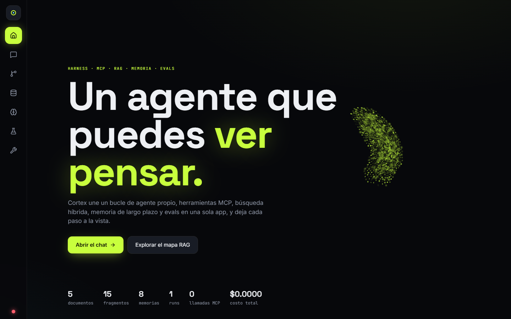
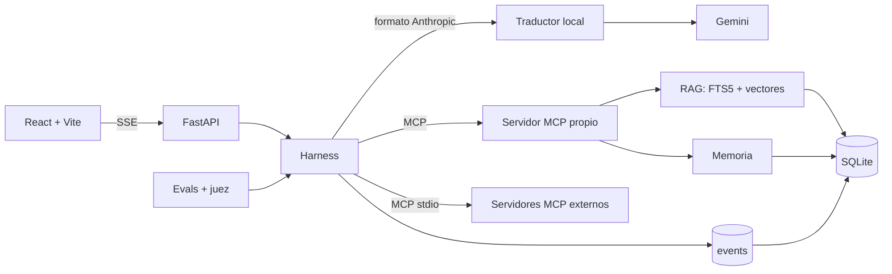
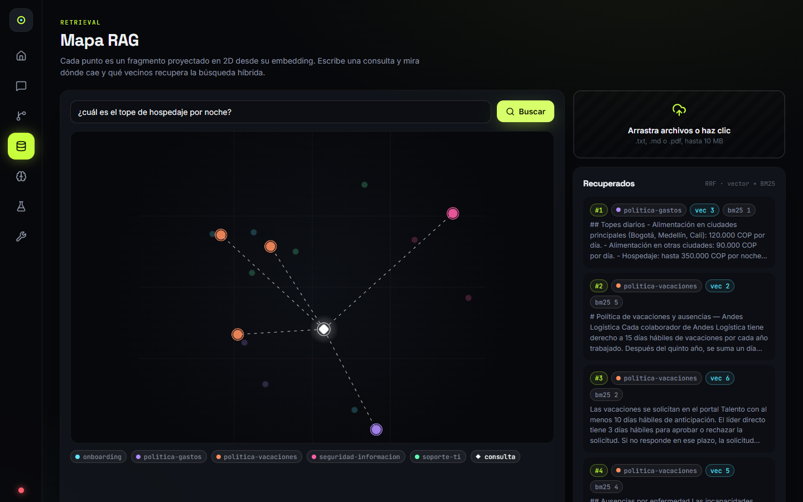
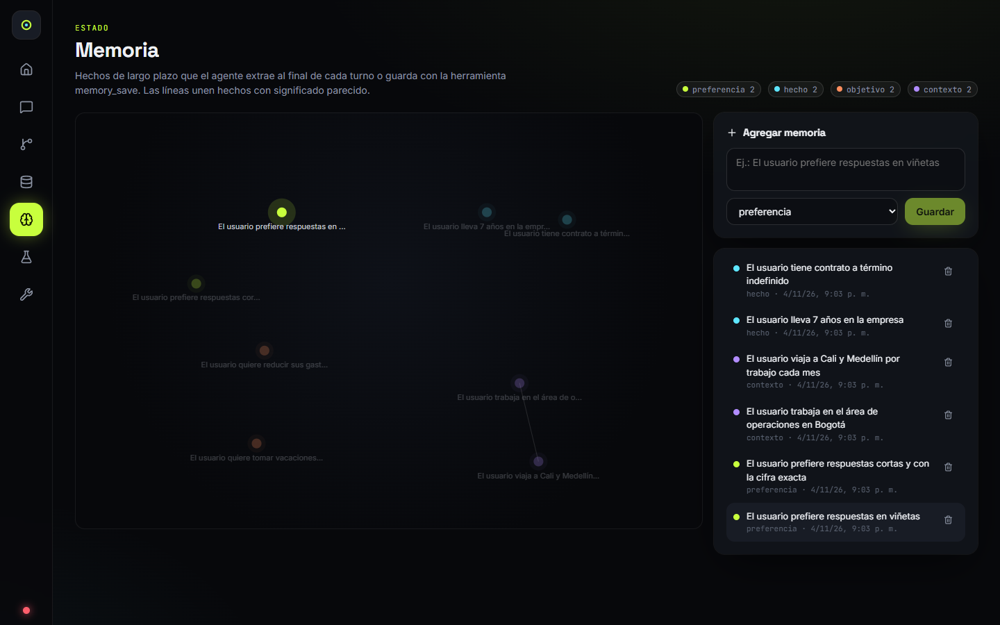
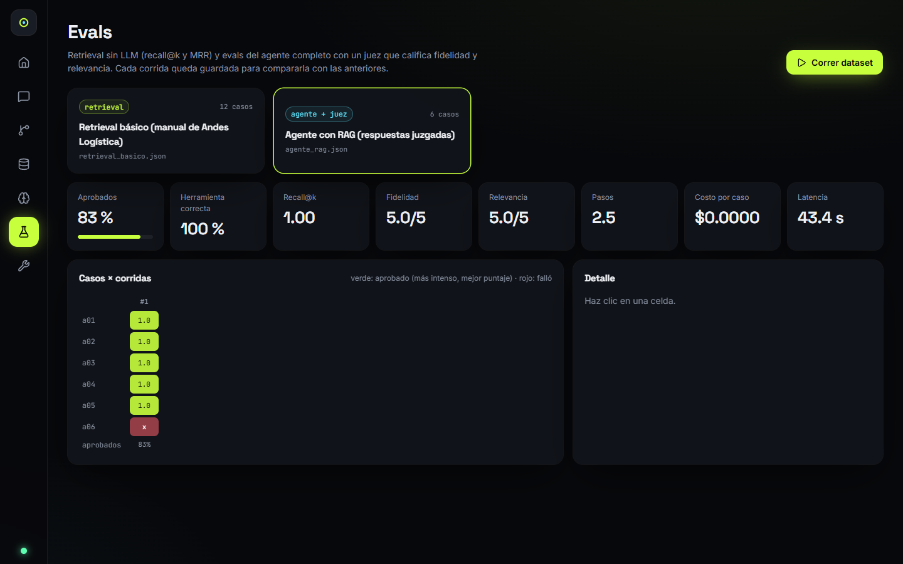
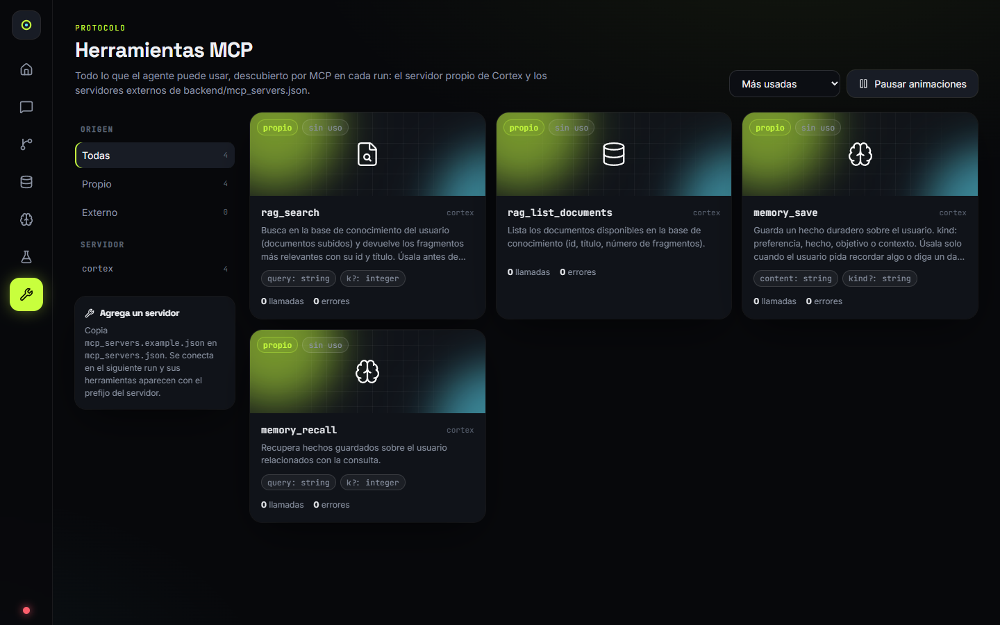
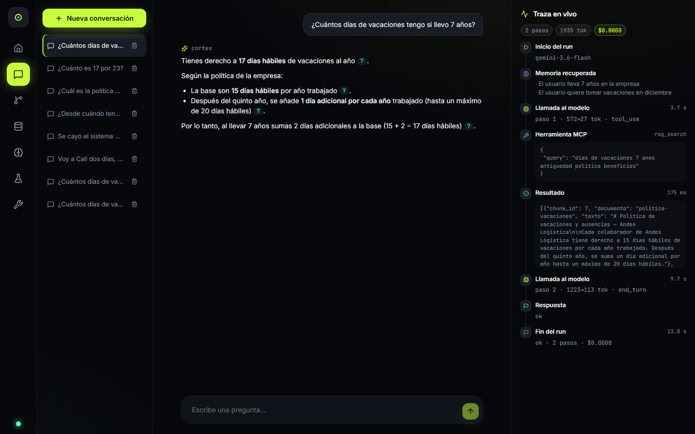
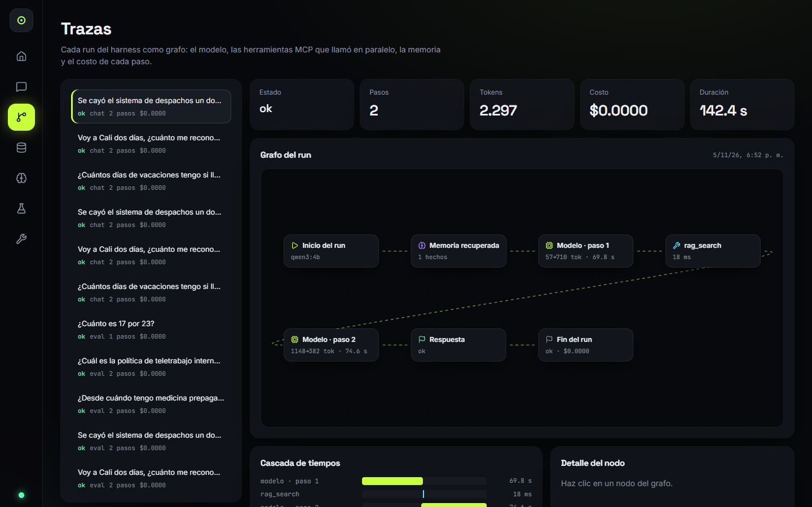

# Cortex Agent

Una sola app que reúne un **harness de agente propio**, **MCP** (servidor y cliente), **RAG híbrido**, **memoria de largo plazo** y **evals**, con vistas de observabilidad para ver qué hace el agente en cada paso.



## Qué hay adentro

| Módulo | Qué hace |
|---|---|
| **Harness** (`backend/app/harness.py`) | Bucle escrito a mano con el SDK de Anthropic, sin frameworks de agentes. Tiene límite de pasos y de costo, ejecuta herramientas en paralelo, maneja cada `stop_reason` (`tool_use`, `pause_turn`, `refusal`, `max_tokens`) y mantiene el historial válido aunque el run se corte. |
| **MCP** (`mcp_server.py`, `tools.py`) | Servidor MCP propio con `rag_search`, `rag_list_documents`, `memory_save` y `memory_recall`. El agente consume **todas** las herramientas por MCP: el servidor propio en proceso y los externos por stdio desde `mcp_servers.json`. |
| **RAG** (`rag.py`) | Ingesta de `.txt`, `.md` y `.pdf`; chunking con solape; búsqueda híbrida BM25 (SQLite FTS5) + vectores (embeddings locales con `fastembed`), fusionada con Reciprocal Rank Fusion; citas por fragmento. |
| **Memoria** (`memory.py`) | Hechos de largo plazo con embedding. Al final de cada turno, un modelo pequeño con salida estructurada extrae hasta 3 hechos; se deduplican por similitud y se inyectan en el siguiente turno. |
| **Evals** (`evals.py`) | Datasets JSON. Retrieval: recall@k y MRR, sin LLM. Agente: herramienta esperada, pasos, costo, latencia y un **juez LLM** que califica fidelidad y relevancia de 1 a 5. Cada corrida se guarda para comparar; también corre en CI. |
| **Trazas** (`events`) | Cada paso del run es un evento en SQLite y se transmite por SSE. El chat, el grafo de trazas y los evals leen del mismo registro. |



## Vistas

| | |
|---|---|
|  **Mapa RAG**: cada fragmento proyectado en 2D; la consulta cae en el mapa y se iluminan los vecinos recuperados, con su puesto en la búsqueda vectorial y en BM25. |  **Memoria**: grafo de fuerzas agrupado por tipo de hecho, con aristas entre hechos de significado parecido. |
|  **Evals**: mapa de calor de casos × corridas; al hacer clic en una celda se ven las métricas y la salida. |  **Herramientas MCP**: catálogo con filtros por origen y servidor, parámetros del schema y uso real. |

También están el **Chat**, con una traza en vivo al lado de la respuesta, y **Trazas**, que muestra cada run como grafo (React Flow) y como cascada de tiempos, junto con el razonamiento resumido del modelo.

| | |
|---|---|
|  **Chat** |  **Trazas** |

## Con qué se probó

| Modelo | Eval de agente | Chat | Notas |
|---|---|---|---|
| **Gemini** (`gemini-3.6-flash`, juez con `gemini-3.5-flash-lite`) | **6 de 6**, 7,9 s por caso | 17 días con cita, 13,8 s | Una corrida en la capa gratuita |
| **Ollama** (`qwen3:4b`, local) | 5 de 6 y 6 de 6 | 28 a 177 s | Una vez respondió 20 días en lugar de 17 |

**No se probó con la API de Claude.** La app usa el SDK de Anthropic porque el traductor y Ollama aceptan ese formato, pero los parámetros propios de Claude que envía el harness (`betas`, `fallbacks`, `thinking`, `cache_control`, `effort`) quedan sin validar. Detalle en [`docs/evidencias`](docs/evidencias/README.md).

## Cómo correrlo

Requisitos: Python 3.12 y Node 20 o superior.

```bat
run.bat
```

La primera vez crea el entorno virtual, instala dependencias, carga el manual de ejemplo (`docs_seed/`, una empresa ficticia) y abre:

- Frontend: http://localhost:5173
- API: http://localhost:8000/docs

Para el chat y los evals de agente, pega una key de [Google AI Studio](https://aistudio.google.com/apikey) en `backend/.env`, que `run.bat` crea así:

```
ANTHROPIC_BASE_URL=http://localhost:8787
ANTHROPIC_AUTH_TOKEN=gemini-proxy
AGENT_MODEL=gemini-3.6-flash
SMALL_MODEL=gemini-3.5-flash-lite
GEMINI_API_KEY=tu_key
```

La app solo habla el formato de Anthropic, así que `backend/app/gemini_proxy.py` traduce las peticiones a Gemini. `run.bat` levanta ese traductor en el puerto 8787 cuando `.env` apunta a él. El costo aparece en $0 porque esos modelos no están en la tabla de precios, y la capa gratuita tiene límites de peticiones.

Sin key funcionan el RAG, el mapa, el catálogo MCP y los evals de retrieval.

### Sin costo y sin internet: modelo local con Ollama

Instala [Ollama](https://ollama.com), corre `ollama pull qwen3:4b` y usa este `backend/.env`:

```
ANTHROPIC_BASE_URL=http://localhost:11434
ANTHROPIC_AUTH_TOKEN=ollama
AGENT_MODEL=qwen3:4b
SMALL_MODEL=qwen3:4b
```

No tiene límite de peticiones, pero una respuesta puede tardar de 30 s a 3 min según la GPU y lo que razone el modelo. Resultados en [`docs/evidencias`](docs/evidencias/README.md).

### Variables opcionales (`backend/.env`)

| Variable | Valor por defecto en el código |
|---|---|
| `AGENT_MODEL` | `claude-opus-5-5` (sin probar) |
| `SMALL_MODEL` (juez y extracción de memoria) | `claude-haiku-5-5` (sin probar) |
| `AGENT_EFFORT` | `medium` |
| `MAX_STEPS` / `MAX_COST_USD` | `8` / `0.50` |
| `EMBED_MODEL` | `sentence-transformers/paraphrase-multilingual-MiniLM-L12-v2`. Si lo cambias, usa una base nueva: los vectores guardados no sirven con otro modelo y la búsqueda falla. |

## Usar el servidor MCP desde otro cliente

El servidor propio también corre por stdio, por ejemplo para Claude Desktop:

```json
{
  "mcpServers": {
    "cortex": {
      "command": "C:/ruta/cortex-agent/backend/.venv/Scripts/python.exe",
      "args": ["-m", "app.mcp_server"],
      "cwd": "C:/ruta/cortex-agent/backend"
    }
  }
}
```

Para darle al agente servidores externos, copia `backend/mcp_servers.example.json` en `backend/mcp_servers.json`. Sus herramientas aparecen con el prefijo del servidor (`filesystem__read_file`).

## Evals

```bash
cd backend
python -m app.evals retrieval_basico.json --k 3 --min-pass 0.8   # sin LLM
python -m app.evals agente_rag.json                               # agente completo + juez
```

El comando sale con código 1 si la tasa de aprobados queda bajo `--min-pass`. El workflow de CI (`.github/workflows/ci.yml`) corre los tests y el eval de retrieval en cada push.

## Tests

```bash
cd backend && python -m pytest -q
```

Son 26 tests. Usan un cliente LLM falso con respuestas guionadas y embeddings deterministas, así que no gastan API ni descargan modelos. Cubren el bucle del harness (herramientas, límite de pasos, rechazo, falta de credenciales), MCP en proceso, la búsqueda híbrida, la memoria, los evals (incluido el juez), la API con SSE y el traductor de Gemini.

## Decisiones y límites conocidos

- **Harness manual en lugar del Tool Runner del SDK**, para controlar y trazar cada paso.
- **Traductor en lugar de reescribir el harness para Gemini.** El harness no cambia, pero el traductor descarta los parámetros propios de Claude.
- **Búsqueda vectorial por fuerza bruta en numpy.** Va bien hasta unos 50 mil fragmentos; más allá conviene `sqlite-vec`.
- **PCA en lugar de UMAP** para el mapa 2D: menos dependencias, a cambio de grupos menos separados.
- **Los servidores MCP externos se abren en cada run.** Es simple y aísla fallos, pero agrega latencia si son lentos al arrancar.
- **Sin autenticación.** Es una app local de un solo usuario; no la expongas a internet tal cual. Rechaza las peticiones que vienen de otros sitios web (`CORS_ORIGINS`).
- **Borrar una conversación borra sus trazas**, pero no los hechos de memoria que salieron de ella: esos se borran en la vista Memoria.

## Licencia

Todos los derechos reservados. El código se publica para consulta como parte de mi portafolio: puedes leerlo, pero no usarlo, copiarlo, modificarlo ni distribuirlo sin mi autorización por escrito. Ver [LICENSE](LICENSE). La excepción son `frontend/src/components/SwarmCursor.tsx` y `SwarmCursor.css`, que vienen de React Bits y mantienen su propia licencia (MIT + Commons Clause): ver [`SwarmCursor.LICENSE.md`](frontend/src/components/SwarmCursor.LICENSE.md). Esos archivos no pueden venderse ni redistribuirse por sí solos.

## Créditos

- Swarm Cursor de [React Bits](https://reactbits.dev/animations/swarm-cursor), en `frontend/src/components/SwarmCursor.tsx`.
- Embeddings: [fastembed](https://github.com/qdrant/fastembed). Grafos: [React Flow](https://reactflow.dev) y [d3-force](https://d3js.org/d3-force).
